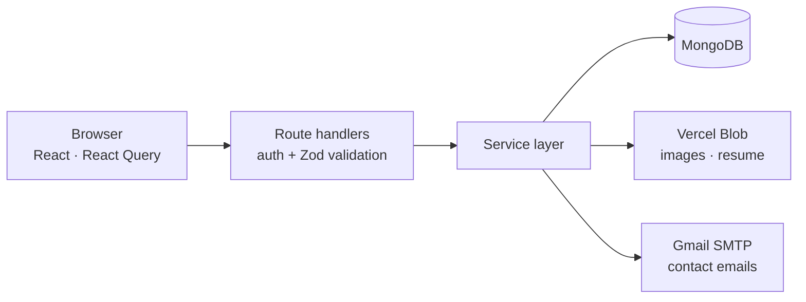

<div align="center">

<br />

# murali<span>.dev</span>

### A developer portfolio that edits itself.

Projects, skills, about details and the career timeline are managed from the
site itself, so content changes never need a redeploy.

<br />

[](https://murali-dev.vercel.app)
[](https://github.com/MD0516/murali.dev/issues)
[](#license)

<br />


<br />

<a href="https://murali-dev.vercel.app">
  
</a>

<br />

[Live demo](#live-demo) ·
[Features](#features) ·
[Tech stack](#tech-stack) ·
[Architecture](#architecture) ·
[REST API](#rest-api) ·
[Getting started](#getting-started) ·
[Deployment](#deployment)

</div>

<br />

---

## Live demo

** [murali-dev.vercel.app](https://murali-dev.vercel.app)**

The site opens with a fake **404 page**. Here's how the intro plays out:

1. Click **Deploy Fix**.
2. Watch the simulated build log run to completion.
3. The portfolio is revealed.

After you've run it once, the intro is skipped for **24 hours** in the same browser.

> [!NOTE]
> The admin area isn't public. `/login` requires the seeded admin credentials,
> and there is no signup route.

---

## Features

<table>
<tr>
<td width="50%" valign="top">

### For visitors

- Terminal-style hero
- Interactive `ls`-style skills browser
- Project cards that open into detailed views
- Education and work timeline
- Contact form with email notification and an auto-reply
- Light and dark themes with no flash on load
- Downloadable resume

</td>
<td width="50%" valign="top">

### For the admin

- Inline editing on the live page, no separate dashboard
- Add, edit and delete projects, skills and timeline entries
- Edit the About section
- Upload project images and the resume to Vercel Blob

</td>
</tr>
</table>

---

## Tech stack

| Area | Tools |
| :--- | :--- |
| **Framework** | Next.js (App Router), React, TypeScript |
| **UI** | Tailwind CSS v4, Sass, Motion |
| **Data** | MongoDB, Mongoose, Zod |
| **Authentication** | `jose` JWTs, `bcryptjs`, HTTP-only cookies |
| **Uploads & email** | Vercel Blob, Nodemailer (Gmail SMTP) |
| **Hosting** | Vercel |

---

## Architecture



| Principle | What it means |
| :--- | :--- |
| **Thin route handlers** | They check the session, validate input with Zod and call a service. Business logic lives in `lib/services`. |
| **Server-side authorization** | Every mutating route verifies the admin session itself. Hiding the UI is never treated as security. |
| **Central error handling** | Services throw typed errors, and one handler turns them into consistent API responses. |

---

## REST API

The API is served by the same Next.js app under `/api`.

- **Public**: read endpoints and contact submission need no session.
- **Admin**: content changes, uploads and logout require a valid admin session cookie.
- JSON endpoints accept and return JSON unless noted otherwise, and request bodies are validated server-side.

<details open>
<summary><b> Auth</b></summary>

<br />

| Method | Endpoint | Access | Purpose |
| :---: | :--- | :---: | :--- |
| `POST` | `/api/auth/login` | Public | Sign in. Accepts `email`, `password` and optional `rememberMe`, then sets the session cookie |
| `GET` | `/api/auth/session` | Session | Return the current admin details |
| `GET` | `/api/auth/logout` | Admin | End the current admin session |

</details>

<details>
<summary><b> Projects</b></summary>

<br />

| Method | Endpoint | Access | Purpose |
| :---: | :--- | :---: | :--- |
| `GET` | `/api/projects` | Public | List projects |
| `POST` | `/api/projects` | Admin | Create a project |
| `PATCH` | `/api/projects/:id` | Admin | Update a project |
| `DELETE` | `/api/projects/:id` | Admin | Delete a project |
| `DELETE` | `/api/projects/:id/images` | Admin | Remove a project image. JSON body: `{ "imageUrl": "..." }` |
| `PATCH` | `/api/projects/reorder` | Admin | Change project order |

</details>

<details>
<summary><b> Skills</b></summary>

<br />

| Method | Endpoint | Access | Purpose |
| :---: | :--- | :---: | :--- |
| `GET` | `/api/skills` | Public | List skill groups |
| `POST` | `/api/skills` | Admin | Create a skill group |
| `PATCH` | `/api/skills/:id` | Admin | Update a skill group |
| `DELETE` | `/api/skills/:id` | Admin | Delete a skill group |
| `PATCH` | `/api/skills/reorder` | Admin | Change skill group order |

</details>

<details>
<summary><b> About & Timeline</b></summary>

<br />

| Method | Endpoint | Access | Purpose |
| :---: | :--- | :---: | :--- |
| `GET` | `/api/about` | Public | Get About details |
| `PATCH` | `/api/about` | Admin | Update About details |
| `GET` | `/api/timeline` | Public | List timeline entries |
| `POST` | `/api/timeline` | Admin | Create a timeline entry |
| `PATCH` | `/api/timeline/:id` | Admin | Update a timeline entry |
| `DELETE` | `/api/timeline/:id` | Admin | Delete a timeline entry |

</details>

<details>
<summary><b> Uploads & Contact</b></summary>

<br />

| Method | Endpoint | Access | Purpose |
| :---: | :--- | :---: | :--- |
| `POST` | `/api/upload?type=image` or `/api/upload?type=resume` | Admin | Upload one or more files as `multipart/form-data` using the `files` field |
| `POST` | `/api/contact` | Public | Submit a contact message |

</details>

<br />

> [!TIP]
> Protected endpoints use the HTTP-only session cookie established by login.
> Successful responses generally include a `message` and, when applicable, a
> `data` property. Upload responses include the uploaded URLs in `data.urls`.
> Validation and authorization errors are returned through the shared API error
> handler.

---

## Getting started

### Prerequisites

- **Node.js**: a current LTS release
- **MongoDB**: a database (a free Atlas cluster works)
- *Optional*: a **Vercel Blob** store for uploads
- *Optional*: a Gmail [app password](https://support.google.com/accounts/answer/185833) for contact emails

### Setup

**1. Clone and install**

```bash
git clone https://github.com/MD0516/murali.dev.git
cd murali.dev
npm install
cp .env.example .env.local
```

> [!TIP]
> On Windows PowerShell, use `Copy-Item .env.example .env.local` instead of `cp`.

**2. Configure** `.env.local` (see [Environment variables](#environment-variables)), then seed the database and start the dev server:

```bash
npm run seed
npm run dev
```

**3. Open the app**

Visit [localhost:3000](http://localhost:3000) and sign in at
[/login](http://localhost:3000/login) with the `ADMIN_EMAIL` and
`ADMIN_PASSWORD` you set.

> [!NOTE]
> The seed script creates the admin account and adds sample About, skills,
> timeline and project data where those collections are empty. It never
> overwrites existing records. Replace the sample content from the site after
> logging in.

---

## Environment variables

Copy `.env.example` to `.env.local`. These are read on the server only.

> [!CAUTION]
> Never commit real credentials.

| Variable | Required for | Description |
| :--- | :--- | :--- |
| `MONGODB_URI` | App, seed script | MongoDB connection string |
| `JWT_SECRET` | Admin sessions | Session signing secret. Generate with `openssl rand -base64 32` |
| `BLOB_STORE_ID` | Uploads | Vercel Blob store identifier |
| `BLOB_READ_WRITE_TOKEN` | Uploads | Vercel Blob read/write token |
| `SMTP_USER` | Contact email | Gmail address used as the sender |
| `SMTP_PASS` | Contact email | Gmail app password (not your account password) |
| `CONTACT_EMAIL` | Contact email | Inbox that receives contact messages |
| `ADMIN_EMAIL` | Seed script | Email for the initial admin account |
| `ADMIN_PASSWORD` | Seed script | Password for the initial admin account |

> [!IMPORTANT]
> Only `MONGODB_URI` and `JWT_SECRET` are needed to run the app. Blob and email
> variables enable their features, and the admin variables are read only by
> `npm run seed`.

---

## Scripts

| Command | Description |
| :--- | :--- |
| `npm run dev` | Start the development server |
| `npm run build` | Create a production build |
| `npm run start` | Serve the production build |
| `npm run lint` | Run ESLint |
| `npm run seed` | Create the admin account and starter content |

---

## Project structure

```text
src/
├── api/          Client API functions and React Query hooks
├── app/          Pages, layout and API route handlers
├── components/   Portfolio sections, admin forms and UI primitives
├── context/      Shared app and theme state
├── lib/          Database, auth, validation, models and services
├── scripts/      Database seed script
├── styles/       Global Sass and Tailwind theme
└── types/        Shared TypeScript types
```

---

## Design notes

| Decision | Why |
| :--- | :--- |
| **No `/admin` route** | Editing happens inline on the page through modals, and admin-only components are rendered only when the server confirms a valid session. |
| **Single admin, no signup** | The account is created by the seed script, which removes a whole class of registration attacks. |
| **Files live in Blob, not the database** | MongoDB stores only URLs. Old files are deleted when they're replaced. |
| **Styling split** | Tailwind v4 handles theme tokens and utilities. Sass is used for generated button variants and compiles separately from Tailwind's own directives. |

---

## Deployment

1. **Import** the repository from GitHub into [Vercel](https://vercel.com).
2. **Create** a Vercel Blob store and connect it to the project.
3. **Add** every variable from [Environment variables](#environment-variables) in the project settings.
4. **Seed** the production database by running `npm run seed` once.

---

## License

The code is licensed under **MIT**.
Personal content (bio, resume and project write-ups) is **not** licensed for reuse.

---

<div align="center">

### Built by **Murali Dharan**

[](https://github.com/MD0516)
[](https://www.linkedin.com/in/md0516)

<sub>If you like the idea, a star on the repo goes a long way.</sub>

</div>